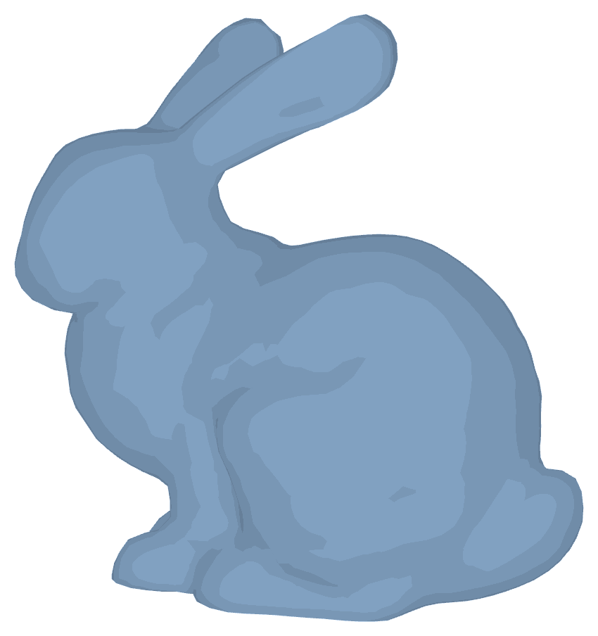

[](https://crates.io/crates/bevy_toon)

# bevy-toon



A tiny toon shader for [Bevy](https://bevyengine.org): flat bands of light, lit from the camera, in the vertex colors of
the mesh.

## How to use

Add the `ToonPlugin`, and give your meshes a `ToonMaterial`:
```rust
App::new().add_plugins(ToonPlugin);

commands.spawn((
  Mesh3d(mesh),
  MeshMaterial3d(materials.add(ToonMaterial::default())),
));
```

## Version Compatibility

| bevy | bevy_toon |
|------|-----------|
| 0.20.0 | 0.3.x, 0.4.x |
| 0.18.0 | 0.2.x |
